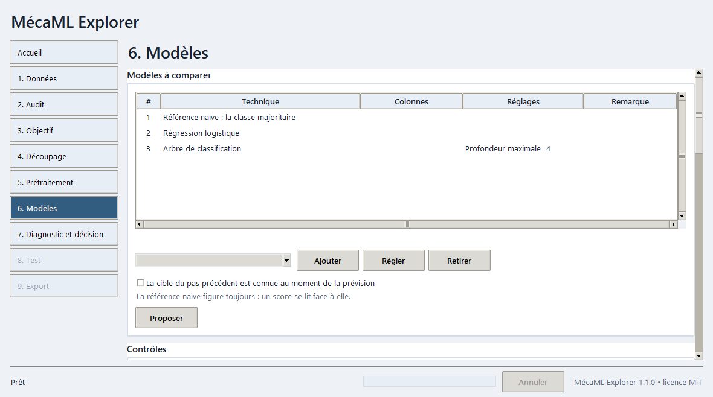
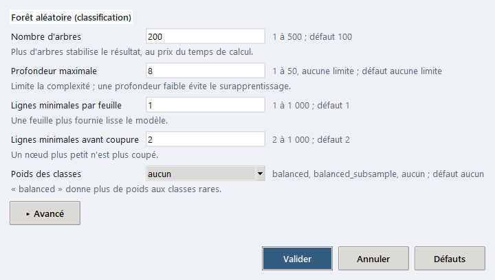

# MécaML Explorer

Application de bureau qui guide un projet d'apprentissage automatique sur données tabulaires, du fichier au rapport, avec un garde-fou à chaque étape. Elle accompagne le livre **Méca-IA** (première édition, 2026) : chaque conseil affiché renvoie au chapitre et à la section du livre qui l'explique, par un identifiant de la forme `T08-2-1`.

L'application illustre ce principe : coder soi-même ses modèles donne la maîtrise de bout en bout, la personnalisation et la compréhension, même quand un logiciel existe : c'est pourquoi chaque projet s'exporte avec un script Python qui le refait sans l'application.



## À quoi elle sert

Elle prend un classeur `.xlsx` ou un fichier `.csv` de mesures ou d'essais et conduit l'ingénieur en neuf étapes : lecture, audit, objectif, découpage, prétraitement, modèles, diagnostic, test, export. Elle couvre la régression, la classification et l'analyse sans cible (regroupements, anomalies, composantes principales), sur lignes indépendantes, unités suivies (machines, lots) ou séries chronologiques.

Les garde-fous sont ceux que le livre recommande, appliqués sans qu'on puisse les oublier :

- le jeu de test est mis sous scellé à l'étape 4, avant tout apprentissage, et ne s'ouvre qu'à l'étape 8 ; une nouvelle ouverture rend un score marqué optimiste ;
- le découpage respecte la structure : unités entières, dates, classes, hasard seulement pour des lignes indépendantes ;
- tout ce qui s'apprend (imputation, mise à l'échelle, sélection) est appris sur l'apprentissage de chaque pli de validation, jamais sur le test ;
- une référence naïve (la moyenne ou la classe majoritaire) figure dans toute comparaison : un score ne se lit que par rapport à elle ;
- la fuite de la cible passée (persistance, cible décalée) est détectée, et un compte à rebours comme une durée de vie restante est refusé ;
- une colonne qui décrit une personne (sexe, origine) est signalée en alerte, et un identifiant ne peut pas servir de variable ;
- aucune donnée ne quitte le poste : l'application n'ouvre aucune connexion réseau et n'écrit ses résultats que dans le dossier choisi à l'export.

Ce qu'elle ne fait pas : images et signaux bruts (le livre les traite dans ses chapitres 14 à 16, avec Keras). Elle propose le perceptron multicouche de scikit-learn et, si Keras est installé, un réseau dense Keras facultatif : sans Keras, l'application fonctionne à l'identique et ne le montre pas.

## Installation

Prérequis : Windows 10 ou 11, Python 3.12 avec Tk (c'est le cas de l'installeur officiel de python.org).

```bat
py -3.12 -m venv .venv
.venv\Scripts\activate
python -m pip install -r requirements.txt
python -m pip install -e .
```

La première commande de pip installe les bibliothèques aux versions testées (numpy, pandas, scikit-learn, scipy, matplotlib, openpyxl, joblib). La seconde rend le paquet `mecaml` importable.

## Lancement

```bat
Lancer_MecaML.bat
python -m mecaml
```

Le fichier `Lancer_MecaML.bat` lance l'application avec le Python 3.12 du poste, et non celui de `.venv` : après une installation dans `.venv`, lancez plutôt `python -m mecaml`, l'environnement activé ; sans Python 3.12, ou sans l'une des bibliothèques, il dit ce qu'il faut installer. L'option `-t` (`python -m mecaml -t`) ouvre la fenêtre, mène un jeu d'exemple jusqu'à l'export et la ferme : c'est un essai de bon fonctionnement. La procédure d'installation du paquet et de construction d'un exécutable autonome est dans `build/README.md`.

Un exécutable Windows autonome (`MecaML.exe`, sans Python) se construit avec PyInstaller : voir `build/README.md`. Il n'est pas signé numériquement : au premier lancement, Windows SmartScreen peut afficher « Windows a protégé votre ordinateur » ; choisir « Informations complémentaires » puis « Exécuter quand même ». Une stratégie de contrôle d'application d'un poste d'entreprise peut aussi bloquer un binaire non signé : dans ce cas, utiliser `Lancer_MecaML.bat`.

Une fenêtre s'ouvre sur l'accueil. Le rail de gauche liste les neuf étapes ; il n'ouvre que les étapes atteintes et la suivante.

## Mode d'essai

`python -m mecaml -t` ouvre la fenêtre, mène le jeu d'exemple `Traitement_Acier` jusqu'à l'export dans un dossier temporaire, puis la ferme ; le code de sortie est 0 quand tout a réussi.

## Données et confidentialité

Aucune donnée ne quitte le poste : l'application n'ouvre aucune connexion réseau et n'écrit que dans le dossier choisi à l'export. Les fichiers lus ne sont jamais modifiés.

## Premier projet en 5 minutes

Le jeu `Controle_Conformite` (569 pièces, 30 descripteurs de forme et de texture, une colonne `etat_piece` qui dit si la pièce est conforme ou rebut) se trouve dans le dossier `examples/`. On y cherche à reconnaître les rebuts.

1. À l'accueil, cliquer sur **Controle_Conformite** : le fichier est lu à l'étape 1. Cliquer sur **Auditer**.
2. À l'étape 2, lire le profil des colonnes : `id_piece` est reconnu comme identifiant et ne servira pas de variable. Lire les constats ; s'il y a des alertes, les lire puis cliquer sur **Tout acquitter**. Cliquer sur **Définir l'objectif**.
3. À l'étape 3, la cible `etat_piece` et la classe positive (le rebut) sont proposées. Cliquer sur **Fixer l'objectif**, puis sur **Découper**.
4. À l'étape 4, cliquer sur **Sceller le test** : le jeu de test est mis de côté. Cliquer sur **Prétraiter**.
5. À l'étape 5, cliquer sur **Appliquer** (la proposition par défaut convient). À l'étape 6, cliquer sur **Entraîner et comparer** : la référence naïve, la régression logistique et un arbre sont comparés par validation croisée. Lire la colonne « Gain sur la référence ».
6. À l'étape 7, examiner la matrice de confusion et le seuil, puis cliquer sur **Retenir ce modèle**. À l'étape 8, cliquer sur **Ouvrir le test (une seule fois)** et comparer le score de test au score de validation.
7. À l'étape 9, choisir un dossier de sortie et cliquer sur **Exporter** : le rapport, le classeur des chiffres, le modèle, le script Python et le projet rejouable sont écrits.

Le guide `USER_GUIDE.md` détaille chaque écran. Pour refaire le projet exporté sans interface, en désignant le classeur de données (l'export n'en garde pas de copie) :

```bat
python -m mecaml.cli rejouer chemin\vers\projet.json -d chemin\vers\le_classeur.xlsx -v
```

L'option `-v` compare les scores retrouvés aux scores attendus.

## Régler un modèle

À l'étape 6, **Ajouter** place un modèle du catalogue dans la comparaison ; **Régler** (ou un double clic sur sa ligne) ouvre la fenêtre de ses réglages. Chaque modèle montre de 3 à 6 réglages principaux, avec un libellé français, la plage permise, la valeur par défaut et une aide d'une ligne ; les réglages secondaires sont repliés sous **Avancé**, et **Défauts** remet tout à zéro. Une valeur hors plage est refusée avec un message qui nomme le réglage et la plage ; le cœur applique le même refus à un projet rejoué ou lu en ligne de commande. Quelques modèles n'offrent pas trois réglages utiles (bayésien naïf, vote, AdaBoost de classification, références naïves) : tous leurs réglages sont alors montrés.



Keras est facultatif (`python -m pip install -r requirements-keras.txt`) : s'il est installé, deux modèles de plus apparaissent (réseau dense en régression et en classification). Ils se comparent comme les autres, mais n'ont pas de script exportable : l'export est refusé tant qu'un réseau Keras figure dans la comparaison.

## Jeux d'exemple

Quatre petits classeurs de `examples/` (régression, classification, série chronologique par machines, anomalies sans cible) servent à essayer l'application et aux tests ; le détail est dans `examples/README.md`. Les jeux plus nombreux du livre sont dans le dépôt de l'ouvrage.

## Le livre et le dépôt

Le livre **Méca-IA** explique chaque notion que l'application met en œuvre. Ses exercices, ses programmes Python et ses jeux de données sont publiés dans le dépôt `Meca-IA_Ed2026` : <https://github.com/philippe-amuzuga/Meca-IA_Ed2026>.

## Pour les développeurs

```bat
python -m pip install -r requirements-dev.txt
python -m pytest -q
python -m ruff check .
```

La suite de tests tourne sans réseau. Deux variables d'environnement, facultatives, activent des tests de plus : `MECAML_JEUX` désigne le dossier des classeurs du dépôt du livre, `MECAML_LISTE_LIVRE` le fichier de la liste publiée des techniques du livre. Les tests d'interface demandent un écran et s'ignorent sans lui.

Organisation du code, dans `src/mecaml/` :

- `core/` : le cœur, sans interface (lecture, audit, découpage, prétraitement, catalogue de 75 techniques et leurs réglages bornés, apprentissage, métriques, diagnostic, rapport, session) ;
- `ui/` : l'interface Tkinter, qui n'applique aucune règle et enchaîne des appels du cœur ;
- `textes/` : les textes de l'interface et les textes pédagogiques, par clés ; les libellés et aides des réglages sont dans `core/hyperparametres_textes.py` ;
- `cli.py` : la ligne de commande, qui rejoue un projet sans interface.

## Licence

Licence MIT pour le code, voir le fichier `LICENSE`. Copyright (c) 2026 Philippe Amuzuga. Les jeux d'exemple gardent la licence de leur source, indiquée dans `examples/README.md` (CC BY 4.0 pour Iris et Breast Cancer Wisconsin).
