# Guide utilisateur de MécaML Explorer

Ce guide suit l'application écran par écran, de l'accueil (S0) à l'export (S9). Les captures montrent le jeu d'exemple `Controle_Conformite` (classification de pièces conformes ou rebuts), sauf mention contraire. L'installation et le lancement sont décrits dans le `README.md`.

Les renvois au livre ont la forme « chapitre 8, section 8.2 (T08-2-1) » : l'identifiant `T08-2-1` ne change jamais, même si le livre est repaginé.

## Principes à connaître

**Le parcours.** Neuf étapes, toujours dans le même ordre. Le rail de gauche n'ouvre que les étapes atteintes et la suivante. Modifier une étape déjà faite refait celles qui en dépendent : l'application revient à cette étape, puis avance de nouveau. Seul le bouton **Nouveau projet** (étape 9) repart de zéro.

**Écrans sobres.** Le titre d'un écran est le nom de son étape ; les explications se lisent dans le livre, par les renvois, et dans la liste des modèles, en sélectionnant une ligne.

**Les constats.** L'audit et les contrôles produisent des constats de trois niveaux.

| Niveau | Sens | Que faire |
|:-|:-|:-|
| Bloquant | Un défaut qui fausserait tout calcul, par exemple un identifiant gardé comme variable ou une cible passée utilisée sans déclaration | Le corriger : le parcours ne continue pas, et un bloquant ne s'acquitte pas |
| Alerte | Un risque à lire avant de continuer | Le lire, suivre son renvoi au livre, puis l'acquitter |
| Information | Une remarque utile, par exemple des valeurs hors des bornes de Tukey | La lire ; aucune action n'est exigée |

Un clic sur un constat affiche son détail, le geste à faire et son renvoi au livre.

**Le bandeau et le pied de page.** Quand une action est refusée, le motif s'affiche en haut de la fenêtre, avec ce qu'il faut corriger. Le pied de page montre l'état courant, une barre de progression et le bouton **Annuler** : tout calcul long (lecture, audit, entraînement, export) tourne en arrière-plan ; la lecture et l'entraînement s'arrêtent sur Annuler, l'audit et l'export vont à leur terme.

**Le jeu de test.** Il est mis sous scellé à l'étape 4 et ne s'ouvre qu'à l'étape 8. Avant l'étape 8, seuls le profil du fichier et la recherche des colonnes qui trahissent la cible lisent toutes les lignes ; aucun modèle n'est ajusté ni choisi sur le test.

## S0 : Accueil

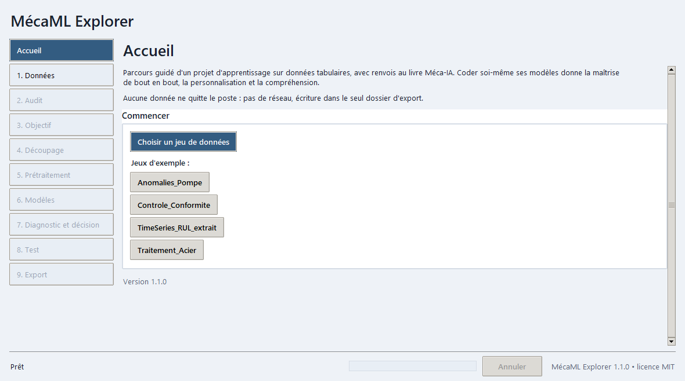

L'accueil rappelle le principe de l'application et ses garanties : aucune donnée ne quitte le poste, aucune connexion réseau, écriture dans le seul dossier choisi à l'export.

- **Choisir un jeu de données** ouvre l'étape 1 pour désigner son propre fichier.
- Les boutons de jeux d'exemple (`Anomalies_Pompe`, `Controle_Conformite`, `TimeSeries_RUL_extrait`, `Traitement_Acier`) chargent directement l'exemple choisi.

## S1 : Données

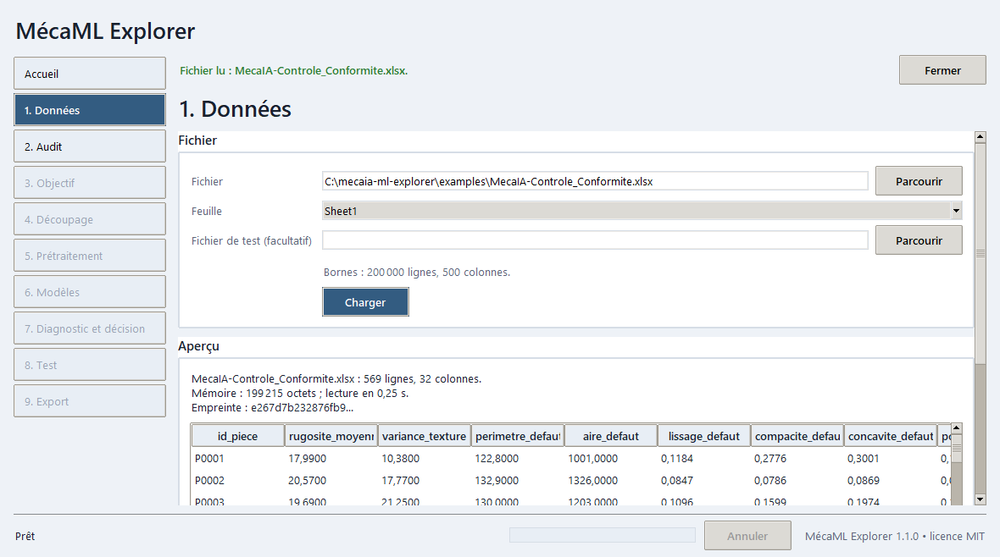

On désigne le fichier et on le lit tel quel : aucune ligne n'est retirée ni modifiée.

- **Fichier** et **Parcourir** : un classeur `.xlsx` ou un fichier `.csv`. **Feuille** : la feuille à lire.
- **Fichier de test (facultatif)** : un jeu de test fourni à part. Si le classeur contient lui-même une feuille de test, une case « Mode challenge » apparaît pour la garder scellée.
- **Charger** : lit le fichier. L'aperçu donne le nombre de lignes et de colonnes, la mémoire, le temps de lecture, l'empreinte du fichier et les premières lignes.
- **Auditer** : passe à l'étape 2.

Les bornes sont de 200 000 lignes et 500 colonnes. Au delà, ou si le fichier est illisible, l'application refuse avec le motif exact. L'empreinte permet de retrouver plus tard le fichier identique.

## S2 : Audit

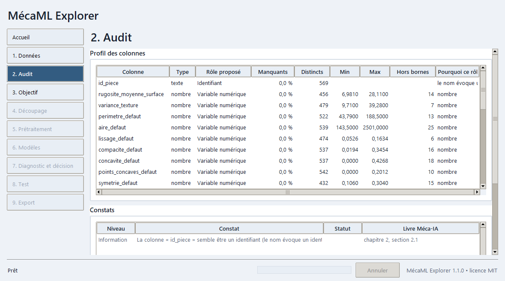

L'audit lit chaque colonne et propose son rôle : variable numérique, variable catégorielle, cible, repère de temps, unité suivie (machine, lot, outil), identifiant ou colonne écartée. La colonne « Pourquoi ce rôle » donne la raison de la proposition (par exemple « le nom évoque un identifiant et les valeurs sont toutes distinctes »). Le profil donne aussi le type, la part de valeurs manquantes, le nombre de valeurs distinctes, le minimum, le maximum et le nombre de valeurs hors bornes.

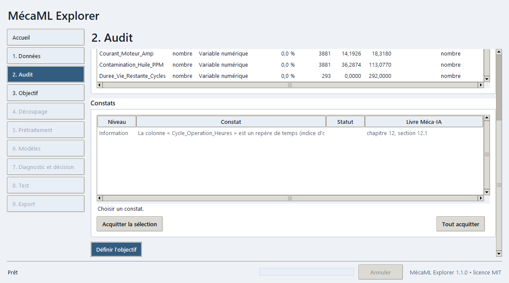

Sous le profil, la liste des constats. Cet exemple de séries chronologiques signale un repère de temps et renvoie à la section 12.1 du livre.

- **Acquitter la sélection** et **Tout acquitter** : reconnaissent des alertes lues. Un bloquant ne s'acquitte pas.
- **Définir l'objectif** : passe à l'étape 3.

Les informations sur les valeurs hors bornes sont repliées dans le profil, pour ne pas noyer les constats.

## S3 : Objectif

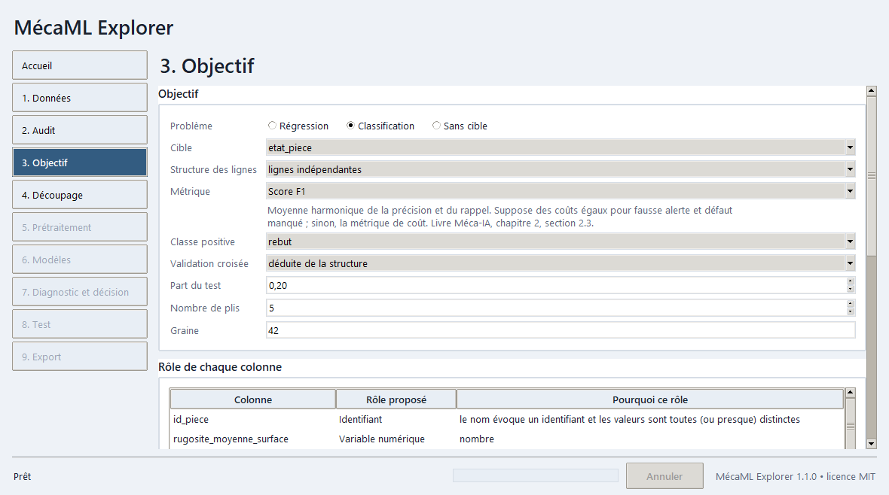

L'objectif fixe tout le reste : il se prend avant de toucher au test.

- **Problème** : régression (une grandeur), classification (une classe) ou sans cible (regroupements, anomalies, composantes).
- **Cible** : la colonne à prédire. L'application en propose une ; **Proposer pour cette cible** recalcule les rôles quand on en change.
- **Structure des lignes** : lignes indépendantes, unités suivies ou série chronologique. Elle commande le découpage et la validation.
- **Métrique** : le score qui jugera les modèles. Sous la liste, une aide dit ce que mesure la métrique, ce qu'il faut regarder et où la lire dans le livre. Le choix du coût d'un faux positif et d'un faux négatif apparaît pour la métrique de coût.
- **Classe positive** (classification à deux classes) : la classe que l'on cherche à repérer, par exemple le rebut. L'application la propose ; elle n'est jamais devinée en silence. Au delà de deux classes, il n'y a pas de classe positive : précision, rappel et F1 sont des moyennes macro.
- **Validation croisée**, **Part du jeu de test**, **Nombre de plis**, **Graine** : réglages de la validation. La validation est déduite de la structure sauf choix contraire permis.

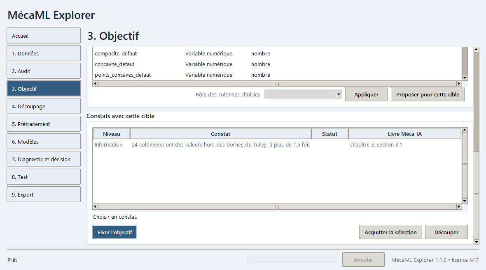

Plus bas, le tableau des rôles se corrige : sélectionner des colonnes, choisir un rôle, **Appliquer**. Les constats se rejouent avec la cible choisie. Une colonne qui décrit une personne (sexe, âge, origine) est signalée en alerte : elle ne doit pas servir d'entrée à un modèle.

**Fixer l'objectif** valide les choix ; **Découper** passe à l'étape 4.

## S4 : Découpage

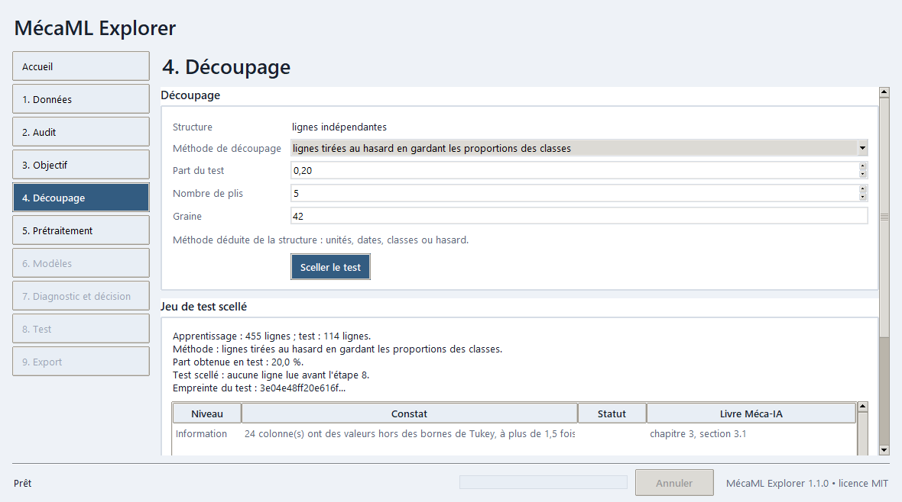

L'application déduit la méthode de la structure : unités entières pour des machines ou des lots, ordre des dates pour une série, proportions des classes pour des lignes indépendantes avec une classe rare, hasard sinon. On règle la part du jeu de test, le nombre de plis et la graine.

**Sceller le test** met de côté le jeu de test. L'écran donne alors les effectifs d'apprentissage et de test, la part obtenue, la méthode et l'empreinte du test. La part obtenue peut s'écarter de la part visée quand les unités entières l'imposent ; l'écart est signalé. Sans cible, il n'y a pas de test : toutes les lignes servent à l'analyse. Avec un jeu de test fourni à part, il reste scellé jusqu'à l'étape 8.

**Prétraiter** passe à l'étape 5.

## S5 : Prétraitement

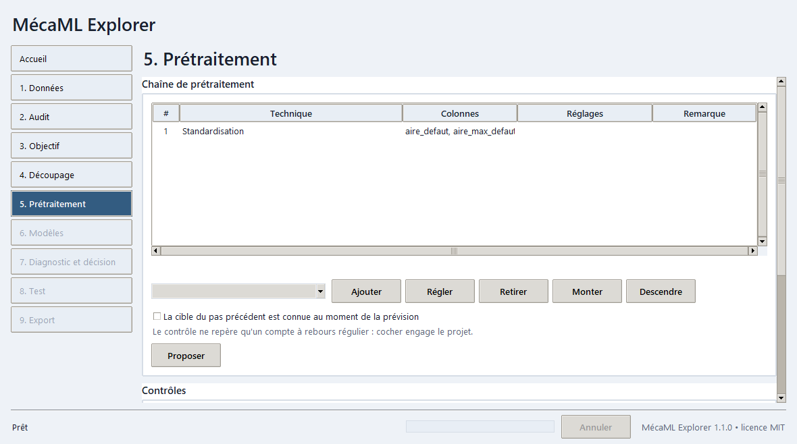

L'application propose, par rôle de colonne, une chaîne de prétraitement (imputation, encodage, mise à l'échelle, sélection). Tout ce qui s'apprend l'est sur l'apprentissage de chaque pli de validation, jamais sur le test.

- La liste se modifie : **Ajouter** (choisir une technique dans la liste déroulante), **Régler** (colonnes visées et paramètres), **Retirer**, **Monter** et **Descendre** pour l'ordre. En sélectionnant une ligne, on lit ce que fait la technique, ce qu'il faut regarder et son renvoi au livre.
- **Proposer** revient à la proposition de l'application ; **Contrôler** relit la chaîne et affiche les avertissements.
- La case « La cible du pas précédent est connue au moment de la prévision » est décochée par défaut. Elle conditionne les techniques qui lisent la cible passée (persistance, cible décalée). Le contrôle ne repère qu'un compte à rebours régulier, comme une durée de vie restante, que l'application refuse même si la case est cochée ; cocher la case engage le projet.
- **Appliquer** valide la chaîne et passe à l'étape 6.

## S6 : Modèles

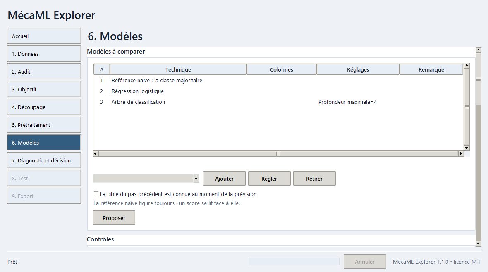

On choisit les modèles à comparer. La référence naïve (la moyenne en régression, la classe majoritaire en classification) figure dans toute comparaison : un score ne se lit que par rapport à elle. Les boutons **Ajouter**, **Régler**, **Retirer** et **Proposer** fonctionnent comme à l'étape 5, et les techniques trop lourdes pour le nombre de lignes sont annotées.

### Régler un modèle

**Régler**, ou un double clic sur la ligne du modèle, ouvre ses réglages.

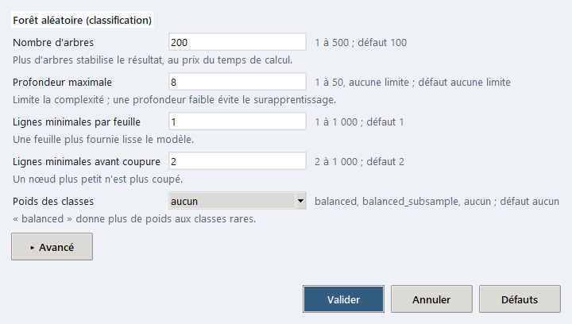

- Chaque modèle montre de 3 à 6 réglages principaux : le libellé français, le champ, la plage permise suivie de la valeur par défaut, et une aide d'une ligne. Quelques modèles n'en offrent pas trois (bayésien naïf, vote, AdaBoost de classification, références naïves) : tous leurs réglages sont montrés.
- **Avancé** déplie les réglages secondaires (par exemple l'élagage d'un arbre, le tirage avec remise d'une forêt).
- Un champ laissé à sa valeur par défaut ne change rien. **Défauts** remet toute la fenêtre à zéro.
- Une valeur hors plage, ou qui n'est pas un nombre, est refusée avec un message qui nomme le réglage et la plage permise (« Nombre d'arbres : « 0 » est hors bornes (1 à 500). »). Le cœur applique le même refus à un projet rejoué.
- La virgule et le point décimal sont acceptés ; un choix se fait dans la liste ; « aucune limite » se saisit comme une valeur (profondeur d'un arbre).
- Pour un vote ou un empilement, la fenêtre propose les modèles à combiner, de 2 à 6, parmi ceux du catalogue.
- Les modèles de la comparaison montrent leurs réglages en clair dans la colonne « Réglages » (« Nombre d'arbres=200 »).

**Keras est facultatif.** S'il est installé, deux modèles de plus sont proposés : le réseau dense Keras en régression et en classification, avec leurs réglages (couches, époques, pas d'apprentissage, taille de lot, abandon). Sans Keras, rien n'est affiché de plus. Ces réseaux n'ont pas de script exportable : l'export est refusé, avec ce motif, tant que l'un d'eux figure dans la comparaison ; leur colonne « Remarque » le rappelle.

**Entraîner et comparer** lance la validation croisée en arrière-plan ; elle peut être annulée.

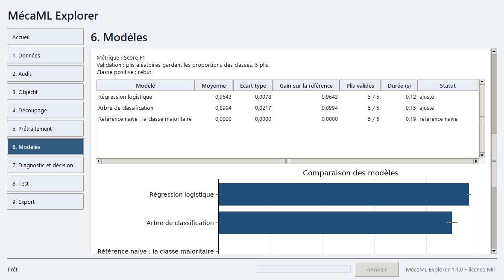

Le tableau comparatif donne, par modèle, la moyenne du score, l'écart type entre plis, le gain sur la référence, le nombre de plis où le score est défini (« 5 / 5 »), la durée et le statut. Un score se lit par son gain : un gain proche de zéro est un échec. Un modèle qui échoue est signalé avec son motif sans arrêter la comparaison.

Plus bas, la **recherche de réglages**, facultative, essaie les réglages d'une grille bornée (grille complète ou tirage aléatoire) sur les mêmes plis. Son meilleur score est optimiste, car le réglage est choisi sur ces plis ; **Utiliser le meilleur** le reporte dans la liste, qu'il faut ensuite relancer pour le comparer aux autres.

**Diagnostiquer** passe à l'étape 7.

## S7 : Diagnostic et décision

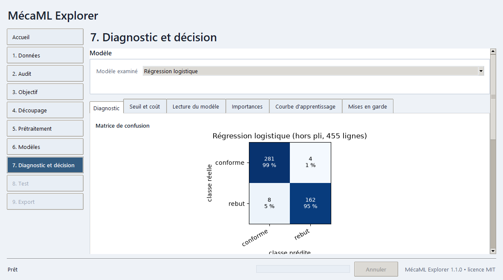

Le diagnostic porte sur des prédictions faites hors pli : des lignes que le modèle n'avait pas apprises. On choisit le **Modèle examiné**, puis on lit les onglets.

- **Diagnostic** : valeurs vraies et prédites avec résidus (régression), matrice de confusion, courbes ROC et précision rappel (classification).
- **Seuil et coût** : précision, rappel et coût selon le seuil de décision ; **Seuil de coût minimal** propose le seuil qui minimise le coût avec les deux coûts saisis.
- **Lecture du modèle** : coefficients, importances par impureté, règles de l'arbre.
- **Importances** : importance par permutation.
- **Courbe d'apprentissage** : score selon le nombre de lignes d'apprentissage.
- **Mises en garde** : les points que le diagnostic demande de contrôler.

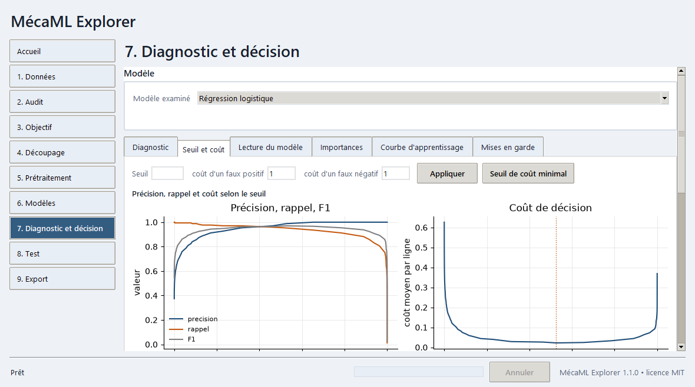

**Retenir ce modèle** fige la décision, avec son seuil, avant l'ouverture du test. Un modèle qui n'a pas été comparé est refusé.

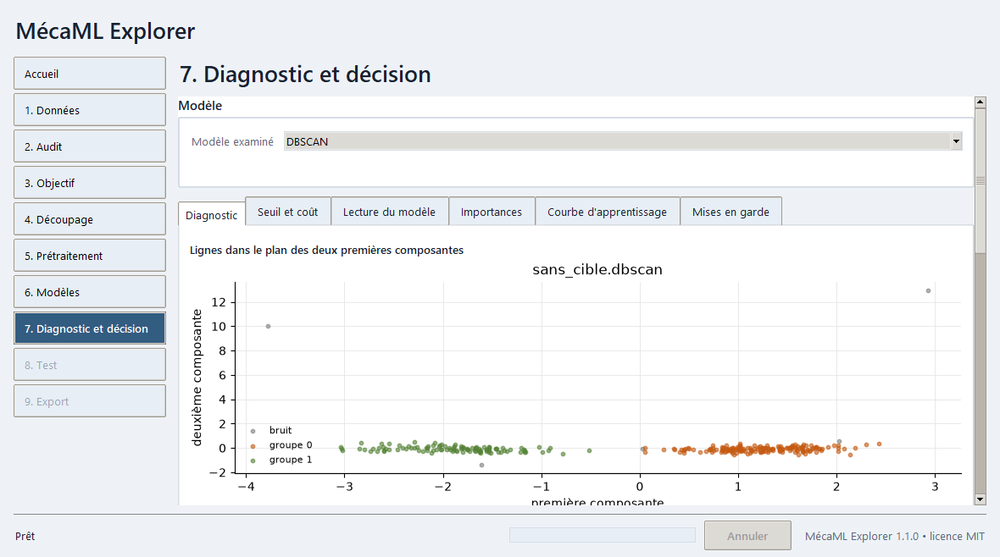

Sans cible, l'onglet montre les composantes (variance, poids des variables, lignes dans le plan des deux premières), le profil et l'effectif de chaque groupe, et les lignes les plus anormales. Il n'y a ni test ni étape 8 : on passe directement à l'export.

## S8 : Test

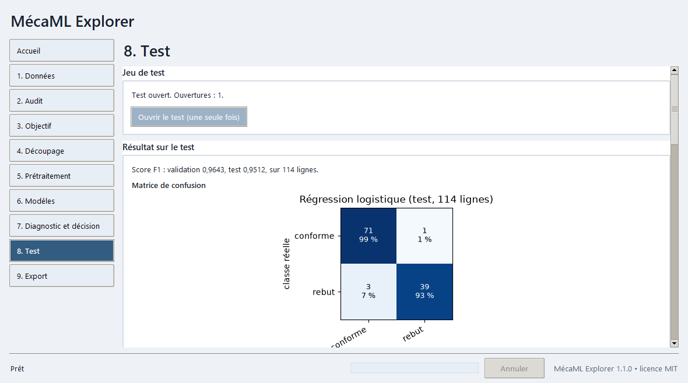

Le test mesure ce que le modèle retenu donnera sur des données neuves. **Ouvrir le test (une seule fois)** demande une confirmation, puis évalue le modèle. L'écran donne le score de validation, le score de test et leurs figures. Le bouton se grise ensuite.

Comparer les deux scores : un test nettement plus faible que la validation signale un surapprentissage ou une fuite. Si le test avait déjà été ouvert, le score est marqué « optimiste » : il ne départage plus honnêtement les modèles.

**Exporter** passe à l'étape 9.

## S9 : Export

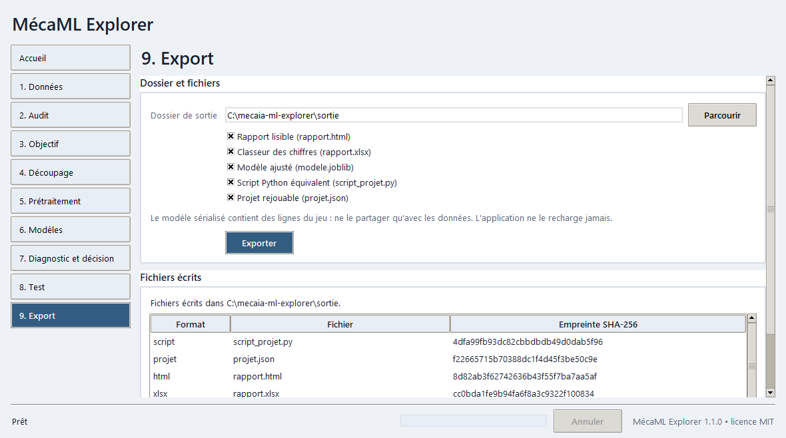

On choisit un dossier de sortie et les formats à écrire :

| Fichier | Contenu |
|:-|:-|
| `rapport.html` | Rapport lisible, sans adresse externe : résumé, données, audit, découpage, prétraitement, comparaison des modèles, décision, test, reproductibilité, limites |
| `rapport.xlsx` | Classeur des chiffres du rapport |
| `modele.joblib` | Modèle ajusté, avec le contexte nécessaire à la prévision |
| `script_projet.py` | Script Python qui refait le projet sans l'application |
| `projet.json` | Projet rejouable, avec les scores attendus |

L'écran liste les fichiers écrits avec leur empreinte SHA-256. Le modèle sérialisé contient des lignes du jeu : ne le partager qu'avec les données ; l'application ne charge jamais un modèle sérialisé. L'export est refusé tant qu'il reste un constat à traiter.

**Ouvrir le dossier** et **Ouvrir le rapport** ouvrent le résultat ; **Nouveau projet** repart de l'accueil.

Pour rejouer un projet exporté sans interface :

```bat
python -m mecaml.cli rejouer chemin\vers\projet.json -d chemin\vers\le_classeur.xlsx -v
```

L'option `-d` désigne le classeur de données : l'export n'en garde pas de copie, et sans cette option la commande le cherche à côté du `projet.json`. L'option `-v` compare les scores rejoués aux scores attendus. Le script `script_projet.py` s'exécute aussi seul avec Python : c'est la voie pour aller plus loin que l'application, en modifiant le code.

## Autres commandes en ligne

```bat
python -m mecaml.cli auditer mon_fichier.xlsx
python -m mecaml.cli proposer mon_fichier.xlsx -c ma_colonne -s projet.json
```

`auditer` affiche les constats d'un fichier ; `proposer` écrit un projet à relire, puis à rejouer avec `rejouer`.

## En cas de difficulté

| Constat | Cause probable | Que faire |
|:-|:-|:-|
| Le bouton de l'étape suivante ne fait rien | Une alerte reste à acquitter ou un bloquant à corriger | Lire le bandeau en haut de la fenêtre et le constat concerné |
| Le fichier est refusé à l'étape 1 | Fichier hors des bornes (200 000 lignes, 500 colonnes) ou illisible | Lire le motif affiché, réduire ou corriger le fichier |
| Un modèle est annoté « coupé » | Technique lourde au-delà de 20 000 lignes | Choisir une technique plus légère |
| La persistance ou la cible décalée est refusée | La cible du pas précédent n'est pas déclarée connue, ou la cible décompte | Cocher la case seulement si la cible passée est connue à la prévision ; une durée de vie restante est refusée |
| Une valeur de réglage est refusée | Elle sort de la plage permise ou n'est pas un nombre | Lire le message : il donne la plage ; **Défauts** remet les valeurs d'origine |
| L'export est refusé à cause d'un réseau Keras | Un réseau dense figure dans la comparaison et n'a pas de script équivalent | Le retirer de la liste à l'étape 6, puis relancer l'entraînement |
| Un score de test est dit optimiste | Le test avait déjà été ouvert | Ouvrir un nouveau projet sur des données nouvelles : sur les mêmes données, le test reste marqué déjà vu |
| La fenêtre ne s'ouvre pas | Tk absent de l'installation de Python | Réinstaller Python 3.12 depuis python.org avec Tk |

## Pour aller plus loin

Le livre **Méca-IA** explique chaque notion, avec ses exercices et ses jeux de données dans le dépôt `Meca-IA_Ed2026` : <https://github.com/philippe-amuzuga/Meca-IA_Ed2026>.
